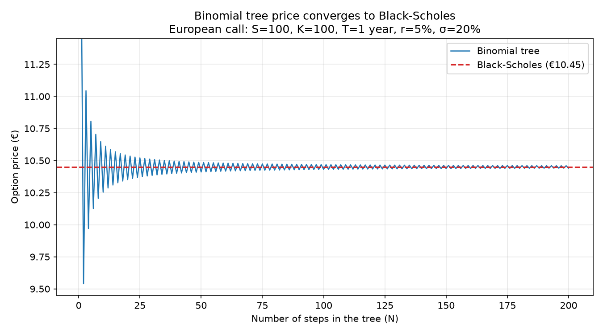
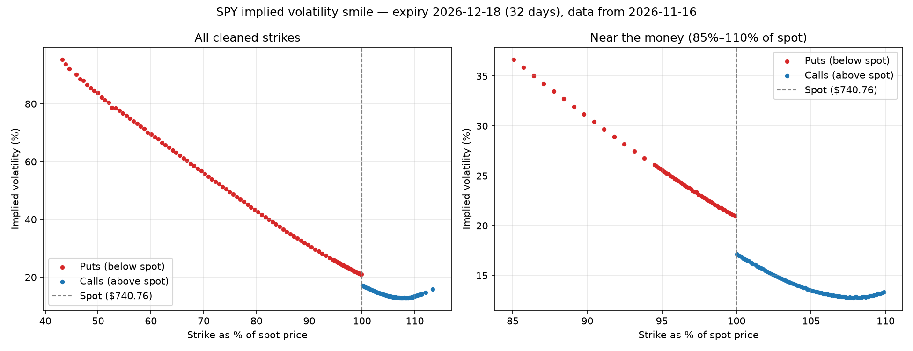
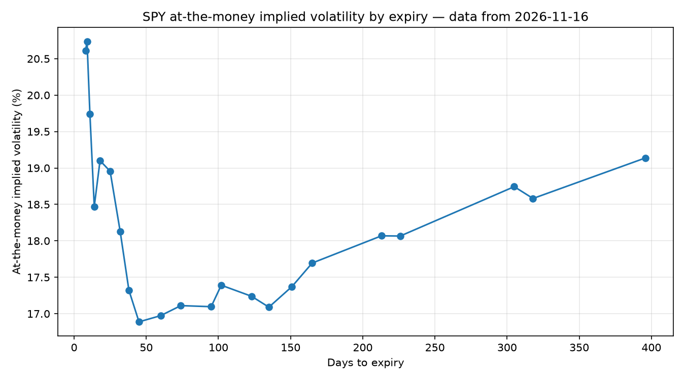
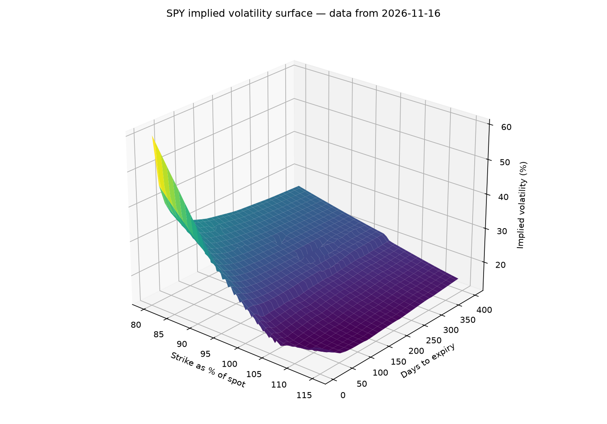
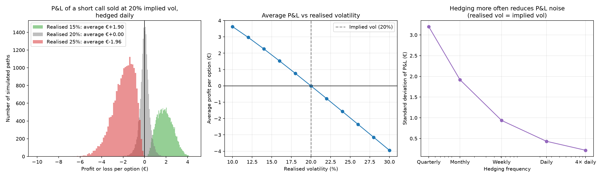

# Options Pricing & Volatility Surface Toolkit

A Python library for pricing options and building implied volatility surfaces from live market data.

> 🚧 Work in progress. Results, charts and a live demo link will go here.\

## Results

### Binomial tree converges to Black-Scholes



Two independent pricing methods agree: as the number of steps grows, the binomial tree's price oscillates and settles onto the Black-Scholes value (€10.45), confirming both implementations.

### Monte Carlo estimate converges to Black-Scholes


The Monte Carlo price and its 95% confidence interval narrow towards the Black-Scholes value as simulations increase. The error shrinks with the square root of the number of simulations: 100× more simulations gives a 10× tighter estimate.
Antithetic variates reduce the standard error by ~30% at no extra simulation cost (equivalent to doubling the number of simulations).

### Real market data: SPY volatility smile



Implied volatilities calculated from live SPY option prices (out-of-the-money options, cleaned for wide spreads and stale quotes). If Black-Scholes were exactly right, this would be a flat line. Instead, implied volatility rises steeply for low strikes: deep out-of-the-money puts are priced at up to ~94% volatility against ~13% near the money, reflecting the market's demand for crash protection. A smaller upturn appears for far out-of-the-money calls.

### Term structure



At-the-money implied volatility has a hockey-stick shape: elevated at the front (~20.7% for options expiring within a week), dipping to ~16.9% around 45 days, then rising steadily to ~19.1% at one year. The upward slope beyond 45 days is typical; the elevated front end suggests the market is pricing more near-term turbulence than medium-term.

### Implied volatility surface



Combining strike and expiry: the put skew is steepest for short-dated options (deep out-of-the-money puts priced at up to ~60% volatility) and flattens as expiry lengthens. An interactive version is in `images/surface_SPY.html`. Data snapshot saved in `data/` for reproducibility.

### Delta-hedging: where an option seller's profit comes from



Simulating 20,000 paths of selling a call at 20% implied volatility and delta-hedging it daily. The hedge removes exposure to the stock's direction (the stock's expected return has no effect on P&L), leaving a bet on volatility: the seller profits when realised volatility comes in below implied and loses when it comes in above. Average P&L closely follows the rule of thumb **P&L ≈ vega × (implied − realised)**. Hedging more frequently reduces the spread of outcomes, following a square-root rule.

## Features

- [x] Black-Scholes pricing for European calls and puts
- [x] Probability of finishing in the money
- [x] Analytic Greeks (delta, gamma, vega, theta, rho), validated against numerical derivatives
- [x] Binomial tree pricer (European and American)
- [x] Monte Carlo pricer
- [x] Implied volatility solver
- [x] Volatility smiles and 3D surface from real option chains
- [x] Delta-hedging simulation
- [ ] Interactive Streamlit dashboard

## Getting started

```bash
python3 -m venv .venv
source .venv/bin/activate
pip install -r requirements.txt
python -m pytest
```

## Project structure

```
optionskit/      the library code
tests/           automated tests
notebooks/       exploration and charts
```
